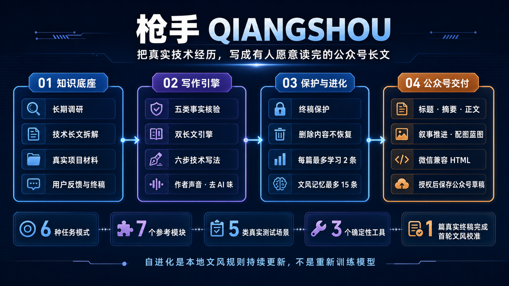

<p align="center">
  <a href="https://github.com/shengjidaguai-china"><strong>升级打怪开源社区</strong></a> 首批开放共建项目 ·
  <a href="https://github.com/shengjidaguai-china">点击组织首页右上角 <strong>Follow</strong></a>，及时获取新项目与共建活动
</p>

<!-- README_SYNC: source=main@006074f; updated=2026-11-15 -->

<p align="center">
  <a href="./README.md">简体中文</a> · English
</p>

<div align="center">

# 枪手 QIANGSHOU

### Turn real engineering work into a long-form article people finish reading

[](https://github.com/shengjidaguai-china/qiangshou-skill/stargazers)
[](https://github.com/shengjidaguai-china/qiangshou-skill/releases/tag/v0.1)
[](./qiangshou/SKILL.md)
[](./LICENSE)
[](https://github.com/shengjidaguai-china/qiangshou-skill/issues)
[](https://github.com/shengjidaguai-china/qiangshou-skill/commits/main)

**If Qiangshou saves you an article, give it a Star. It is how more independent developers find it.**



</div>

## What it is

Qiangshou is a Chinese-first long-form writing Skill for independent developers, vibe coders and AI builders.

It reads repositories, code, logs, experiments, commit history, user feedback and the author's own account, establishes what is actually verifiable, and only then writes the story: conflict, trade-off, implementation and the boundary of the result.

It does not expand a README into an essay, and it does not sand the author's own voice off with fancier words.

> The goal is to keep the author intact while making real technical work credible, readable and worth finishing.

## Why it exists

Most technical creators do not run out of material. They run out of structure:

- The facts are scattered across repositories, logs, experiments and chat history;
- Generic AI turns a project into a feature list;
- The technical part is solid, but a general reader cannot follow it;
- Models inflate numbers and user feedback to make a story travel;
- After polishing, the author's plain words, mood and judgement are gone;
- The author has already signed off the final draft, and the AI keeps "improving" it;
- Content the author deleted comes back in the next round;
- Every new article starts with explaining the author's writing style again.

Qiangshou turns those problems into one executable content pipeline.

## Core capabilities

### 1. Reads from many sources

Materials it can work from:

- README, license and architecture documents;
- Key code, tests, logs and commit history;
- Experiment data, charts and timelines;
- Interviews, comments and user feedback;
- Earlier drafts, reference articles and confirmed final drafts.

It does not expand the material. It looks for the facts, the core problem, the conflict, the choice and the consequence first.

### 2. Five kinds of evidence

Every strong claim is classified as:

1. Verifiable in the repository;
2. Stated by the author;
3. Third-party feedback;
4. Author inference;
5. Time-sensitive data.

A single comment never becomes a universal effect, a local metric never becomes a global improvement, and inference never gets dressed up as fact.

### 3. Adaptive long-form structure

There is no single chapter template. "Project story" and "opinion piece" only describe the high-level intent; the actual structure is generated from the facts, conflicts, evidence, choices and consequences of that particular article.

Each article picks one dominant progression: event, cognition, decision, experiment or relationship. Everything else may support it but never competes with it. Release retrospectives, engineering post-mortems and iteration reviews stay optional variants instead of multiplying into new fixed engines.

### 4. Six steps for technical depth

```text
问题 → 为什么难 → 尝试与取舍 → 具体实现 → 可量化结果 → 适用边界
```

Depth comes from real problems, engineering decisions and honest limits, not from terminology density.

### 5. The author's voice, minus the AI smell

Qiangshou keeps the author's plain language, humour, self-deprecation, real emotion and technical judgement.

The final pass is delete-first: cut sentences that add no fact, causality, judgement or character change, then rewrite only what is still unclear.

It never polishes everything into a uniform "premium" register, and it never runs a banned-word filter. Template transitions, pseudo-complete lists, repeated summaries and automatic uplift are removed first; the author's uncertainty, failures, revised opinions and natural speech stay.

### 6. Final-draft protection

Once the author says "final draft", "published version" or "this is the version", or a single job already delivered both the visuals and the copyable WeChat HTML:

- The body is no longer polished on its own;
- Existing wording and order do not change;
- Deleted content is never restored;
- Rejected suggestions are not repeated;
- Apart from typos the author explicitly allows, the AI may only suggest.

### 7. Lightweight self-evolution

Whenever a final draft is confirmed, or both the visuals and the copyable WeChat HTML are delivered, Qiangshou diffs its own earlier draft against the author's hand-edited version:

- Text kept as-is stays attributed to the assistant, never to the author;
- Deletions, rewrites and additions are told apart, and pure layout changes never enter the learning loop;
- An inferred preference needs to repeat across at least two different final drafts before it is promoted;
- An explicit instruction takes effect immediately and overrides older signals;
- Text and visual preferences are stored separately, with at most two new or corrected rules per draft;
- "Do not learn from this one" skips the whole step.

Self-evolution runs on anonymous draft IDs and a local signal ledger: deterministic de-duplication, promotion and memory sync, not model retraining. Qiangshou never stores the article itself, and never learns facts, opinions, people, project names, awards or one-off chapter structures.

### 8. WeChat delivery

Depending on what the author authorizes, Qiangshou can also produce:

- The titles, summaries, body, visuals or HTML actually requested;
- Layout-preserving drafts of a frozen text;
- WeChat-compatible inline HTML;
- Markdown tables rendered with inline styles;
- A delivery check that every image stays within 2000px;
- A final validation with no clickable links and no dead local image paths;
- A saved WeChat draft, only after explicit authorization.

Fact tables, progression tables and visual blueprints stay internal unless asked for. Saving a draft is not publishing: no mass send, no publish, no review submission and no scheduled send without separate authorization.

## Current scale

| Capability | Current |
| --- | ---: |
| Task modes | 7 |
| Markdown reference modules | 11 |
| Persistent signal ledgers | 2 |
| Real test scenarios | 15 |
| Deterministic tools | 6 |
| High-level writing intents | 2 |
| Dominant progressions | 5 |
| Evidence types | 5 |
| Technical writing steps | 6 |
| Dynamic memory files | 2 |
| Automated behaviour tests | 45 |
| Rules learned per final draft | 2 |
| Effective rules per memory | 15 |

No complete sample article is stored. The historical baseline covers three author-confirmed hand-edited finals; a preference only becomes evidence when a reliable earlier draft exists, or when the author states the rule explicitly.

## Who it fits

- People with a real project whose articles keep turning into changelogs;
- Writers who want a technical WeChat article without the default AI register;
- People who need story, engineering, facts and reach to hold together;
- People who want the assistant to learn their voice without keeping whole articles;
- People who keep hitting "the final draft got optimized again" or "I deleted that, why is it back".

## How it differs

| Option | Strength | Usual limit |
| --- | --- | --- |
| General AI chat | Fast text | Templates itself, ignores final-draft state |
| Prompt templates | Consistent per run | Retrained every time, no memory of the author |
| Ordinary polishing tools | Quick sentence edits | No evidence chain, no technical spine |
| Human ghostwriter | Deep interviews and writing | Expensive, slow, high communication cost |
| **Qiangshou** | Evidence checks, adaptive structure, final-draft protection, two-memory learning, WeChat delivery | Still needs your real material and your final judgement |

## Install

Qiangshou is a folder of Markdown plus Python standard-library scripts. Copy it into the skills directory of your host:

- Codex: `~/.codex/skills/qiangshou`
- Claude Code: `~/.claude/skills/qiangshou`
- Generic agent directory: `~/.agents/skills/qiangshou`

```bash
git clone https://github.com/shengjidaguai-china/qiangshou-skill.git
mkdir -p ~/.agents/skills
cp -R qiangshou-skill/qiangshou ~/.agents/skills/qiangshou
```

Restart the host and invoke `$qiangshou`.

### Update an existing install

```bash
git clone https://github.com/shengjidaguai-china/qiangshou-skill.git
cp -R qiangshou-skill/qiangshou/. ~/.agents/skills/qiangshou/
```

Back up the dynamic memory and signal ledger first — overwriting them loses the rules learned so far:

- `references/author-voice.md`
- `references/author-voice-signals.json`
- `references/visual-preferences.md`
- `references/visual-preference-signals.json`

## Quick start

### Write a project story

```text
使用 $qiangshou，读取这个项目的仓库、日志和提交记录，
把真实开发过程写成一篇公众号技术长文。
先建立事实边界，再设计主矛盾和文章结构。
```

### Write an opinion piece with evidence

```text
使用 $qiangshou，把我的观点、个人经历和实验材料写成观点实证长文。
公平呈现大众认知，区分实验观察、外部研究和作者判断，
允许实验结果与我最初的预期不同。
```

### Protect a final draft

```text
这是最终发布版。不要修改正文和顺序，只提出必要建议。
这次终稿可以学习文风，但不要保存文章事实和观点。
```

## Architecture

```text
Codex 宿主模型
  └── SKILL.md 控制与任务路由
      ├── 11 个按需加载的 Markdown 参考模块
      ├── 自适应编排与五类事实边界
      ├── 文字 / 视觉双记忆与匿名信号台账
      └── 6 个确定性 Python 工具
```

Progressive loading: `SKILL.md` owns the workflow and the boundaries, the reference modules are read per task, which keeps the context small and the rules from contradicting each other.

## Repository layout

```text
qiangshou/
├── SKILL.md
├── agents/
│   └── openai.yaml
├── references/
│   ├── author-voice.md
│   ├── author-voice-signals.json
│   ├── facts-and-strategy.md
│   ├── format-preserving-layout.md
│   ├── github-readme.md
│   ├── micro-detail-and-counter-narrative.md
│   ├── review-and-deliverables.md
│   ├── self-evolution.md
│   ├── test-scenarios.md
│   ├── visual-preference-signals.json
│   ├── visual-preferences.md
│   ├── wechat-layout-and-draft.md
│   └── writing.md
├── scripts/
│   ├── render_wechat_html.py
│   ├── self_evolution.py
│   ├── validate_readme_pair.py
│   ├── validate_wechat_html.py
│   ├── validate_wechat_images.py
│   └── verify_content_preservation.py
└── tests/
    └── 45 behaviour and contract tests
```

## Maintenance and tests

The behaviour tests depend on the Python standard library only, so they run on any machine with Python 3.9+:

```bash
cd qiangshou
python3 -B -m unittest discover -s tests -q
```

New behaviour starts as a verifiable input and a list of failure signals in `references/test-scenarios.md`, before any implementation.

When changing the Skill, do not overwrite `references/author-voice.md`, `references/visual-preferences.md` or the two `*-signals.json` files: they are runtime memory maintained by `scripts/self_evolution.py`.

## Version

Current source version: **0.1**

Published tags live on the [Releases](https://github.com/shengjidaguai-china/qiangshou-skill/releases) page.

## License

This repository is licensed under the [PolyForm Noncommercial License 1.0.0](./LICENSE). The source is public: personal, study, education, research and other non-commercial use is free, while commercial use requires prior authorization. The `LICENSE` file is the authoritative text.

## Support Qiangshou

If Qiangshou helped you ship an article, protected a final draft, or finally got a technical project read to the end, give it a Star.

<div align="center">

### ⭐ Star is the most direct support an independent project gets

[Star Qiangshou](https://github.com/shengjidaguai-china/qiangshou-skill) · [Open an issue](https://github.com/shengjidaguai-china/qiangshou-skill/issues) · [See releases](https://github.com/shengjidaguai-china/qiangshou-skill/releases)

</div>
